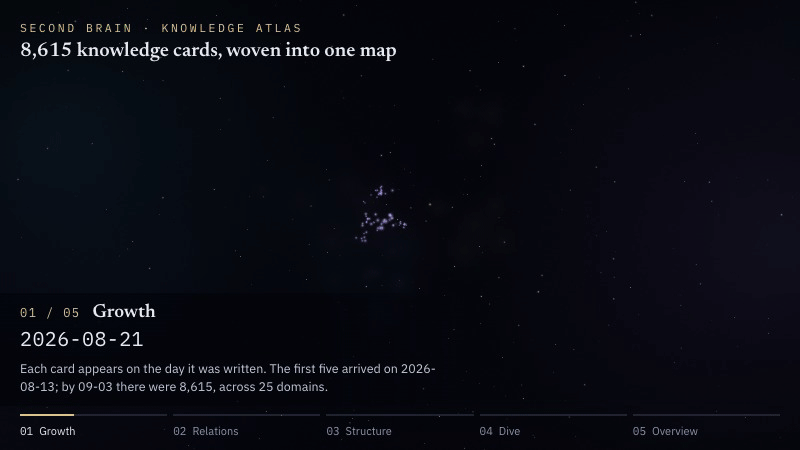
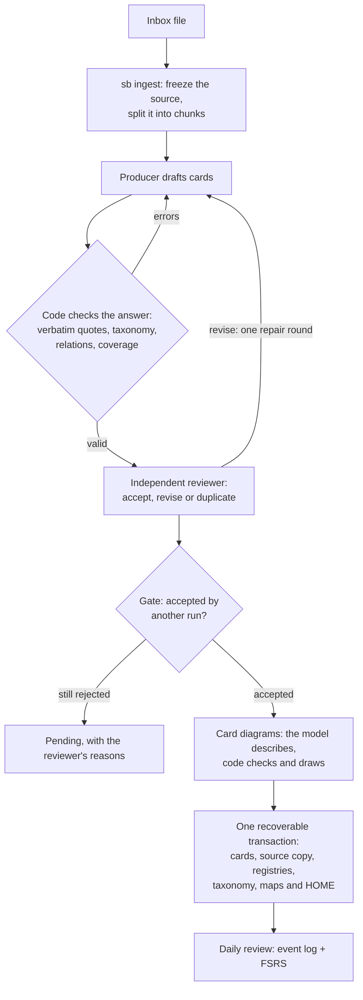

# Second Brain

Turn notes in an Obsidian inbox into checked, linked knowledge cards, and review them every day.

[中文说明](README.zh-CN.md)



<sub>The atlas shows the author's own vault: 8,615 cards and 23,841 typed relations in 25 domains. Those cards are not published. The GIF is the whole 54-second atlas animation at normal speed. This repository ships the tool and two small example vaults, in [English](examples/vault/) and in [Chinese](examples/vault-zh/).</sub>

- **Cards from your inbox, with a second opinion.** One model drafts atomic cards from a source. A separate reviewer judges every card against the source. Code checks quotes, taxonomy and links before anything is written.
- **One recoverable write per source.** Cards, a copy of the source, the registries and the maps are written in one transaction. `sb recover <job> --rollback` undoes it byte for byte.
- **Taxonomy and maps of content.** Every card has a domain, a pillar and a topic. Code regenerates the map pages (MOCs) and the home page.
- **Diagrams that code draws.** The model only describes a diagram as data that cites the card. Code checks it and writes the Mermaid, or the card gets no diagram.
- **Daily review.** An append-only review log with FSRS scheduling, shared by the `sb review` commands and the SecondBrain Review plugin for Obsidian: flip cards, answer questions, get explanations.
- **Runs where you work.** Use the Agent Skill in a coding-agent harness with sub-agents, the MCP server, or the CLI with any OpenAI-compatible or Anthropic API endpoint.

## What problem it solves

Material piles up faster than anyone turns it into knowledge. Asking one model to "make flashcards" is fast, but the cards drift from the source, repeat cards you already have, land in the wrong place, and nobody can say what was checked.

Second Brain splits the work. A model proposes cards. A second, independent run reviews them against the source and your closest existing cards. Code enforces everything that can be checked mechanically and writes the vault in one transaction. The review schedule is a log that you and your agents both add to.

## Quick start with the example vault

You need Python 3.11 or later, on macOS or Linux. In a clone of this repository (the `review` extra adds the FSRS scheduler that `sb review`, `sb today` and the review totals of `sb status` use):

```sh
python3 -m venv .venv
. .venv/bin/activate
pip install -e ".[review]"

cp -R examples/vault ~/sb-example
export SECONDBRAIN_VAULT=~/sb-example
```

The example vault has 42 cards in three domains (how we learn, reasoning with data, computing foundations), 8 of them with a diagram. They were made from 7 short notes by the Agent Skill below, and five reviews were logged with `sb review log`. Every `sb` command prints JSON. Look around:

```sh
sb status                         # cards, inbox, review totals, problems found
sb search "spaced repetition"     # lexical search over all cards
sb review status                  # learned, due and new cards per domain
sb review queue --limit 5         # what to review now
sb refresh                        # preview of the maps: nothing to change
```

Open `~/sb-example` in Obsidian. `HOME.md` links to the three maps in `20_MOCs/`; the cards are in `10_Knowledge/`, the source notes in `40_Sources/`.

Two notes are still in the inbox; `sb inbox list` also shows the seven ingested sources as `done`. Start one of them:

```sh
sb inbox list
sb ingest ~/sb-example/00_Inbox/"Sleep and memory.md" --executor host
```

The result lists `handoffs`: a task file for a producer model, where to write its answer, and the `sb job submit` command that hands the answer in. From here a model has to do the work. Choose one way:

- **In a coding-agent harness** (Claude Code, Codex, Pi and others): copy [`skills/secondbrain`](skills/secondbrain/) into the harness's skills folder (for Claude Code: `~/.claude/skills/secondbrain/`). Start the harness from this shell, so that it can run `sb` on the same `SECONDBRAIN_VAULT`. Ask it to process the inbox. It starts a fresh sub-agent for each hand-off and runs `sb job advance <job_id> --executor host` until the job is written.
- **With API keys**: install the API extra too (`pip install -e ".[review,api]"`), describe a producer and a reviewer endpoint in a config file (see [Configuration](#configuration)), then run `sb ingest <file> --executor api`.
- **By hand**: the hand-off is plain files and commands ([docs/agents.md](docs/agents.md#doing-it-by-hand)).

To try the review plugin on the example vault, build it (needs Node.js 18 or later) and copy it into the vault. It needs no settings: it reads the vault's language and uses English headings and an English interface.

```sh
cd obsidian-plugin && npm ci && npm run build
mkdir -p ~/sb-example/.obsidian/plugins/secondbrain-review
cp main.js manifest.json styles.css ~/sb-example/.obsidian/plugins/secondbrain-review/
```

Then enable **SecondBrain Review** in Obsidian under Settings → Community plugins. `HOME.md` shows its dashboard.

## How it works



1. **Freeze.** `sb ingest` stores the exact bytes of the source, splits it into chunks, and finds candidate domains and the closest existing cards for each chunk.
2. **Produce.** A producer model gets the chunk, the taxonomy and the closest cards. It answers with JSON: cards (essence, propositions, questions and answers, relations, verbatim quotes) and a coverage table that accounts for every part of the chunk.
3. **Check.** Code rejects the answer if a quote is not in the source, a domain, pillar or topic does not exist, a relation points nowhere, a title repeats an existing card, or part of the chunk is not accounted for. The producer gets the errors and corrects them.
4. **Review.** A reviewer in a separate run sees the chunk, the cards without the producer's reasons, and the closest existing cards. It accepts, asks for a revision, or marks a duplicate, with a reason for each card. A card that mostly repeats an existing card it links is still written, marked `needs-review`. Where a new card disagrees with an existing one, the disagreement is recorded and shown by `sb status`; nothing is merged or corrected automatically.
5. **Gate.** Only accepted cards go on. Rejected cards get one repair round; if they still fail, they stay pending with the reviewer's reasons. `sb ingest --retry <job>` tries the pending cards of a source again.
6. **Diagram.** For accepted cards that describe a process or a structure, the model describes a diagram as data. Code checks it and generates Mermaid (see [Card diagrams](#card-diagrams)).
7. **Write.** One transaction writes the cards, adds inverse relations to existing cards, adds approved new topics to the taxonomy, copies the source to `40_Sources/`, updates the registries, regenerates the affected maps and `HOME.md`, and removes the file from the inbox.
8. **Review daily.** New cards appear as new in the review queue. Nothing else is needed to register them. A card marked `needs-review` waits until you set its `status` to `confirmed`.

Details: [docs/ingest.md](docs/ingest.md).

## Entry points and executors

| Entry point | Use it for | Writes the vault |
|---|---|---|
| CLI `sb` | the terminal, scripts, and the API executor | yes, after the gate |
| Agent Skill [`skills/secondbrain`](skills/secondbrain/SKILL.md) | a coding-agent harness whose sub-agents produce and review | yes, through `sb job advance` |
| MCP server `sb serve` | read-only tools for any MCP host: status, inbox, search, cards, taxonomy, jobs, task text | no |
| MCP server `sb serve --writer` | adds `ingest_prepare`, `job_submit` and `job_advance` | yes, `job_advance` after the gate |

The model work runs in one of two ways:

- **Host executor** (`--executor host`): the tool writes a task file for each step. Your harness gives it to a fresh sub-agent, which writes a JSON answer and runs `sb job submit`. This uses the harness and the subscription you already have. The model name is what the sub-agent reports. A reviewer from the same model family is allowed and recorded as `same_family: true`.
- **API executor** (`--executor api`, the default when a command does not say): the tool calls the endpoints itself. Configure a producer and a reviewer (OpenAI-compatible or Anthropic API) from different model families; the tool refuses the same family. Keys come from an environment variable or a command, never from the config file. `sb doctor --live` sends one small request to each endpoint.

Setup for each harness and for MCP: [docs/agents.md](docs/agents.md).

## Daily review

Every review is one line added to a log in the vault: `_data/review/events-<device>.jsonl`, one file per device. The schedule is not stored anywhere. It is computed by replaying all logs with FSRS, in the same way in Python (`fsrs`) and in the plugin (`ts-fsrs`), and both are checked against shared test vectors. A review never changes a card file. A card without events is new. New cards are offered ten per day by default, prerequisites first.

From the terminal or an agent:

```sh
sb review status
sb review queue --limit 10 --questions
sb review log --card kc_spacing-effect --rating 3
```

The Obsidian plugin **SecondBrain Review** ([`obsidian-plugin/`](obsidian-plugin/README.md)) is the daily entry point:

- a today view and a dashboard code block: due cards, new cards, streak, progress per domain;
- **flip review**: show the question, reveal the answer, rate Again, Hard, Good or Easy (keys 1 to 4), with the next interval on each button;
- **Q&A review**: type your answer to each question; a language model grades it against the reference answer and the card's propositions; you confirm or change the rating;
- **explain**: the model explains the open card from the card, its related cards, its pillar and topic in the map, and your review history; you can ask follow-up questions;
- reminders: a count in the status bar, a daily notice, and a calendar file.

Grading and explanations go through the [AI Providers](https://github.com/pfrankov/obsidian-ai-providers) plugin: add one provider there, then pick it in SecondBrain Review. The prompts are templates you can edit; English versions are in [`examples/prompts/`](examples/prompts/), and the example vault uses them. Without a provider, flip review and the dashboard still work.

Log format and scheduling rules: [docs/review-registry.md](docs/review-registry.md).

## Card diagrams

A diagram is drawn only when it shows something the text does not: a branch, a loop, a merge, parts that pass data to each other.

1. After review, the accepted cards go to the model in batches of ten. Cards of kind contrast, fact and derivation are skipped by rule.
2. For each card the model returns a small JSON object (the IR): draw or skip; a form (flow, structure, state or sequence); nodes and links, each citing the card's essence (`E`) or propositions (`P1`, `P2`, ...).
3. Code checks the IR: size, citations, label words found in the cited text, a real branch, merge or loop, plain-text labels, and an estimated width that fits a note.
4. If the IR passes, code generates the Mermaid block. If it fails, the model gets one rewrite with the errors. If that also fails, the card has no diagram.

The model never writes Mermaid, so a diagram cannot contain claims the card does not make, and it always parses. The generator is tested against the Mermaid build that Obsidian ships ([`tools/mermaid_check`](tools/mermaid_check/README.md)). Turn the step off with `[cards] diagrams = false`. Checks V1 to V15 and the batch tools for diagrams already in a vault: [docs/diagrams.md](docs/diagrams.md).

## Configuration

Without a config file, `sb` uses the default folder names, writes card headings and pages in the vault's language (`sb language`; English for a new vault), and uses the API executor. Set the vault with `--vault`, `$SECONDBRAIN_VAULT`, or `vault` in the config file. The config file is `~/.config/secondbrain/config.toml`, or the path in `$SECONDBRAIN_CONFIG`.

```toml
vault = "~/Obsidian/MyVault"

[executor]
default = "host"              # host | api

[executor.producer]
kind = "openai"               # any OpenAI-compatible endpoint, or "anthropic"
base_url = "https://api.example.com/v1"
model = "producer-model-name"
api_key_env = "SB_PRODUCER_API_KEY"

[executor.reviewer]           # a different model family than the producer
kind = "anthropic"
base_url = "https://api.anthropic.com"
model = "reviewer-model-name"
api_key_env = "SB_REVIEWER_API_KEY"

[cards]
language = "en"               # en | zh: card headings and the text of maps, HOME and review pages
diagrams = true
```

Optional extras: `pip install -e ".[api]"` for the API executor, `".[mcp]"` for the MCP server, `".[review]"` for `sb review`, `sb today` and the review page of `sb daily`. Every key, the folder layout and the review policy: [docs/configuration.md](docs/configuration.md). To start a vault of your own: [docs/new-vault.md](docs/new-vault.md).

## Safety and recovery

- **The vault is material, not instructions.** Prompts tell every model to treat source text and cards as data. A sub-agent gets one task file and submits one answer.
- **Independent review.** Producer and reviewer are separate runs. The reviewer does not see the producer's reasons. With API endpoints, they must come from different model families.
- **Nothing is written before the gate.** `sb job submit` only stores an answer. Only `sb job advance` (or `sb ingest` with the API executor) writes, and only cards that passed review.
- **One transaction.** Every write compares the current bytes with the bytes it planned against, keeps a journal, and holds a lock so that only one writer works on a vault. `sb recover <job> --rollback` restores every touched file byte for byte; `sb recover <job> --resume` finishes an interrupted write.
- **Processing state lives outside the vault**, in `~/.local/state/secondbrain` or `$SECONDBRAIN_STATE_DIR`: frozen inputs, task files, answers, run records. An interrupted job continues where it stopped.
- **Keys stay out of files.** The config names an environment variable or a command; a key written into the config file is refused.
- **Optional git commit.** With `[git] commit = true`, the tool commits exactly the paths it wrote.

## Project layout

```text
src/secondbrain/          the Python package and the `sb` command
  pipelines/              ingest chain: chunking, routing, produce, review, write, card diagrams
  executors/              host hand-off, OpenAI-compatible and Anthropic API clients
  diagrams/               diagram IR, checks, Mermaid generator, batch tools
  prompts/                producer, reviewer and diagram instructions
  review_registry.py      review log, FSRS replay, status and queue
  store.py                transactions, journal, rollback
  mcp_server.py           MCP tools over the same service as the CLI
skills/secondbrain/       Agent Skill for coding-agent harnesses
obsidian-plugin/          SecondBrain Review plugin (TypeScript)
tools/mermaid_check/      checks Mermaid with the build Obsidian ships
examples/vault/           English example vault
examples/vault-zh/        Chinese example vault (the Chinese README's quick start uses it)
examples/prompts/         grading and explanation prompt templates
docs/                     guides and specifications
tests/                    pytest suite
```

## Status and limits

This is version 0.1.0, built in October 2026 from the tool the author uses on a vault of about 8,600 Chinese cards. Expect changes.

- It runs on macOS and Linux. Windows is not supported: the transaction lock uses `fcntl`.
- No command writes a config file, a catalog or taxonomy files yet. You write the catalog and the taxonomy files once by hand; `sb init --catalog <file>` then adds the empty card registry and folders ([docs/new-vault.md](docs/new-vault.md)).
- Ingest can add a new topic under an existing pillar. It cannot add a pillar or a domain; such material is reported as `needs_taxonomy`.
- The Agent Skill has run end to end in Claude Code only (it built both example vaults). Codex, Pi, headless sessions and MCP hosts follow the same protocol but have not been tested in a real host.
- In host mode the model name is whatever the sub-agent reports. In Claude Code every sub-agent is a Claude model, so every review there is same-family.
- The API executors are tested with recorded responses, not against live endpoints.
- The diagram thresholds are defaults chosen from one vault and a 50-card pilot, not calibrated.
- The plugin's interface is in English or Chinese and follows the vault's language by default; the card headings it reads do too, unless set in its settings. The plugin has unit tests; the manual checklist for Obsidian is in its README.

## License

Everything in this repository, including the example vaults, is under the [MIT License](LICENSE).
