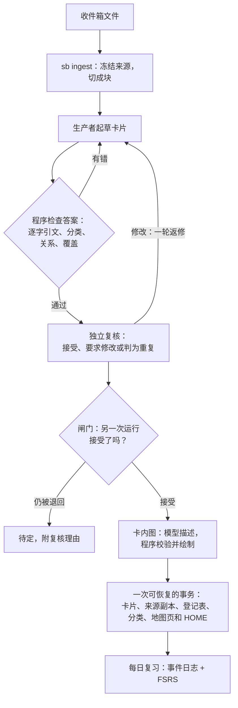

# Second Brain

把 Obsidian 收件箱里的笔记变成经过核对、互相关联的知识卡片，并每天复习。

[English](README.md)


<sub>星图展示的是作者自己的知识库：25 个领域里的 8,615 张卡片和 23,841 条带类型的关系。这些卡片不公开。GIF 是一段 54 秒视频里的三个片段，按原速播放。本仓库提供工具和一个英文[示例库](examples/vault/)。完整视频有中文版和英文版，放在 [Releases 页](../../releases)。</sub>

- **入库有第二道把关。** 一个模型从来源起草原子卡片，另一次独立运行对照来源逐卡复核。写入前，程序检查引文、分类和关系。
- **每份来源一次可恢复的写入。** 卡片、来源副本、登记表和地图页在同一个事务里写入。`sb recover <job> --rollback` 能逐字节撤销。
- **分类与内容地图。** 每张卡都有领域、支柱和主题。地图页（MOC）和首页由程序重新生成。
- **图由程序画。** 模型只用数据描述一张引用卡片内容的图。程序校验后生成 Mermaid，校验不过就不画。
- **每日复习。** 只追加的复习日志加 FSRS 调度，`sb review` 命令和 Obsidian 插件 SecondBrain Review 共用：翻卡、答题、讲解。
- **在你常用的环境里运行。** 可以在编程 agent 的宿主里用 Agent Skill 和子代理，也可以用 MCP 服务，或用 CLI 接任何 OpenAI 兼容或 Anthropic 的 API 端点。

## 解决什么问题

资料进来的速度比整理成知识的速度快。让一个模型直接"做成闪卡"很快，但卡片会偏离原文、和已有卡重复、放错位置，而且说不清到底核对过什么。

Second Brain 把工作拆开。模型提出卡片。另一次独立运行对照原文和最接近的已有卡片复核。凡是能机械检查的，由程序检查，并在一个事务里写入知识库。复习进度记在一份日志里，你和你的 agent 都往里追加。

## 用示例库快速上手

需要 Python 3.11 或更高版本，系统为 macOS 或 Linux。在本仓库的克隆目录里（`review` 依赖提供 FSRS 调度，`sb review`、`sb today` 和 `sb status` 的复习统计要用它）：

```sh
python3 -m venv .venv
. .venv/bin/activate
pip install -e ".[review]"

cp -R examples/vault ~/sb-example
export SECONDBRAIN_VAULT=~/sb-example
```

示例库有 42 张英文卡片，分属三个领域（学习、数据推理、计算基础），其中 8 张带图。它们由下文的 Agent Skill 从 7 份短笔记做成；另用 `sb review log` 记了 5 次复习。每条 `sb` 命令都输出 JSON。先看看库里有什么：

```sh
sb status                         # 卡片数、收件箱、复习统计、发现的问题
sb search "spaced repetition"     # 全库词法检索
sb review status                  # 各领域已学、到期、新卡
sb review queue --limit 5         # 现在复习什么
sb refresh                        # 预览地图页：没有要改的
```

用 Obsidian 打开 `~/sb-example`。`HOME.md` 链到 `20_MOCs/` 里的三张地图；卡片在 `10_Knowledge/`，来源笔记在 `40_Sources/`。

收件箱里还留着两份笔记。开始处理其中一份：

```sh
sb inbox list
sb ingest ~/sb-example/00_Inbox/"Sleep and memory.md" --executor host
```

结果里的 `handoffs` 给出：给生产者模型的任务文件、答案写到哪里、提交答案的 `sb job submit` 命令。接下来要由模型来做，三种方式任选：

- **在编程 agent 宿主里**（Claude Code、Codex、Pi 等）：把 [`skills/secondbrain`](skills/secondbrain/) 复制到宿主的 skills 目录（Claude Code 是 `~/.claude/skills/secondbrain/`）。从这个 shell 启动宿主，让它能对同一个 `SECONDBRAIN_VAULT` 运行 `sb`。让它处理收件箱。它为每个交接开一个新的子代理，并反复运行 `sb job advance <job_id> --executor host`，直到写入完成。
- **用 API key**：另装 API 依赖（`pip install -e ".[review,api]"`），在配置文件里写一个生产者端点和一个复核者端点（见[配置](#配置)），然后运行 `sb ingest <file> --executor api`。
- **手动**：交接只是普通文件和命令（[docs/agents.md](docs/agents.md#doing-it-by-hand)）。

想在示例库上试复习插件，先构建插件（需要 Node.js 18 或更高版本），再复制进库。示例库里已经放好了插件针对英文卡片的设置。

```sh
cd obsidian-plugin && npm ci && npm run build
cp main.js manifest.json styles.css ~/sb-example/.obsidian/plugins/secondbrain-review/
```

然后在 Obsidian 的设置 → 第三方插件里启用 **SecondBrain Review**。`HOME.md` 会显示它的仪表盘。

## 工作方式



1. **冻结。** `sb ingest` 保存来源的原始字节，切块，并为每块找出候选领域和最接近的已有卡片。
2. **生产。** 生产者拿到块文本、分类体系和最接近的卡片，返回 JSON：卡片（本质、命题、问答、关系、逐字引文）和一张覆盖表，交代块里每一部分的去向。
3. **检查。** 引文不在原文里、领域或支柱或主题不存在、关系指向不存在的卡、标题与已有卡重名、块里有部分没交代，程序都会退回答案。生产者按错误改正。
4. **复核。** 复核者在另一次运行里看到块文本、去掉了生产者理由的卡片，以及最接近的已有卡片。它对每张卡给出接受、要求修改或判为重复，并写明理由。
5. **闸门。** 只有被接受的卡继续往下走。被退回的卡有一轮返修；仍不通过的留作待定，附复核理由。`sb ingest --retry <job>` 再试一次某份来源的待定卡。
6. **画图。** 对描述过程或结构的已接受卡片，模型用数据描述一张图。程序校验后生成 Mermaid（见[卡内图](#卡内图)）。
7. **写入。** 一个事务写入卡片，给已有卡片补上反向关系，把批准的新主题加进分类体系，把来源复制到 `40_Sources/`，更新登记表，重新生成受影响的地图页和 `HOME.md`，并把文件移出收件箱。
8. **每日复习。** 新卡在复习队列里以新卡出现，不需要另外登记。

细节：[docs/ingest.md](docs/ingest.md)（英文）。

## 入口与执行方式

| 入口 | 用途 | 是否写知识库 |
|---|---|---|
| CLI `sb` | 终端、脚本、API 执行器 | 是，过闸门之后 |
| Agent Skill [`skills/secondbrain`](skills/secondbrain/SKILL.md) | 由宿主子代理生产和复核 | 是，经 `sb job advance` |
| MCP 服务 `sb serve` | 给任何 MCP 宿主的只读工具：状态、收件箱、检索、读卡、分类体系、任务、任务文本 | 否 |
| MCP 服务 `sb serve --writer` | 另加 `ingest_prepare`、`job_submit`、`job_advance` | 是，`job_advance` 过闸门之后 |

模型的工作有两种执行方式：

- **宿主执行器**（`--executor host`）：工具为每一步写一个任务文件。宿主把它交给一个新的子代理，子代理写 JSON 答案并运行 `sb job submit`。这样用的是你已有的宿主和订阅。模型名由子代理自报。复核者与生产者同属一个模型家族时也接受，记为 `same_family: true`。
- **API 执行器**（`--executor api`，命令没指定时的默认值）：工具自己调用端点。配置一个生产者和一个复核者（OpenAI 兼容或 Anthropic API），两者须来自不同模型家族，同一家族会被拒绝。key 只从环境变量或命令读取，不从配置文件读。`sb doctor --live` 向每个端点发一次小请求。

各宿主和 MCP 的设置：[docs/agents.md](docs/agents.md)（英文）。

## 每日复习

每次复习是追加到库内日志的一行：`_data/review/events-<device>.jsonl`，每台设备一个文件。调度结果不存在任何地方，而是用 FSRS 重放全部日志算出来；Python（`fsrs`）和插件（`ts-fsrs`）算法相同，并用同一组测试向量核对。复习从不改卡片文件。没有事件的卡就是新卡。新卡默认每天给 10 张，先修在前。

在终端或由 agent 使用：

```sh
sb review status
sb review queue --limit 10 --questions
sb review log --card kc_spacing-effect --rating 3
```

Obsidian 插件 **SecondBrain Review**（[`obsidian-plugin/`](obsidian-plugin/README.md)）是每天的入口：

- 今日视图和仪表盘代码块：到期卡、新卡、连续天数、各领域进度；
- **翻卡复习**：先看问题，再看答案，按 Again、Hard、Good、Easy 评级（键 1 到 4），每个按钮上显示下次间隔；
- **问答复习**：逐题写下你的回答；语言模型对照参考答案和本卡命题评分；你确认或改评级；
- **讲解**：模型依据当前卡、相关卡、它在地图里的支柱和主题、你的复习记录讲解，可以继续追问；
- 提醒：状态栏计数、每日一次通知、一个日历文件。

评分和讲解经由 [AI Providers](https://github.com/pfrankov/obsidian-ai-providers) 插件：在那里添加一个提供方，再在 SecondBrain Review 里选它。提示词是可以改的模板；英文版在 [`examples/prompts/`](examples/prompts/)，示例库用的就是它们。不配提供方，翻卡复习和仪表盘照样能用。

日志格式和调度规则：[docs/review-registry.md](docs/review-registry.md)（英文）。

## 卡内图

只有当图能表达文字表达不了的东西时才画：分支、循环、汇合、部件之间传递数据。

1. 复核之后，已接受的卡按每批十张交给模型。对比卡、事实卡和推导卡按规则跳过。
2. 模型为每张卡返回一个小 JSON 对象（IR）：画或不画；图的形式（流程、结构、状态或时序）；节点和连线，每一项都引用卡片的本质（`E`）或命题（`P1`、`P2`……）。
3. 程序检查 IR：规模、引用、标签用词能在被引文字里找到、确有分支或汇合或循环、标签是纯文本、估算宽度放得进笔记。
4. IR 通过就由程序生成 Mermaid 代码块；不通过，模型带着错误清单重写一次；仍不通过，这张卡就不带图。

模型从不写 Mermaid，所以图里不会出现卡片没说的主张，而且一定能解析。生成器对照 Obsidian 内置的 Mermaid 版本测试（[`tools/mermaid_check`](tools/mermaid_check/README.md)）。用 `[cards] diagrams = false` 关闭这一步。V1 到 V15 各项检查，以及处理库里已有图的批处理工具：[docs/diagrams.md](docs/diagrams.md)（英文）。

## 配置

没有配置文件时，`sb` 用默认目录名，按知识库记录的语言写卡片小节名和页面（`sb language`；新库为英文），并用 API 执行器。知识库位置由 `--vault`、`$SECONDBRAIN_VAULT` 或配置文件里的 `vault` 指定。配置文件是 `~/.config/secondbrain/config.toml`，或 `$SECONDBRAIN_CONFIG` 指向的路径。

```toml
vault = "~/Obsidian/MyVault"

[executor]
default = "host"              # host | api

[executor.producer]
kind = "openai"               # 任何 OpenAI 兼容端点，或 "anthropic"
base_url = "https://api.example.com/v1"
model = "producer-model-name"
api_key_env = "SB_PRODUCER_API_KEY"

[executor.reviewer]           # 与生产者不同的模型家族
kind = "anthropic"
base_url = "https://api.anthropic.com"
model = "reviewer-model-name"
api_key_env = "SB_REVIEWER_API_KEY"

[cards]
language = "zh"               # en | zh：卡片小节名，以及地图页、HOME、复习页的文字
diagrams = true
```

可选依赖：API 执行器用 `pip install -e ".[api]"`，MCP 服务用 `".[mcp]"`，`sb review`、`sb today` 和 `sb daily` 的复习页用 `".[review]"`。全部配置项、目录布局和复核策略：[docs/configuration.md](docs/configuration.md)（英文）。从零建自己的库：[docs/new-vault.md](docs/new-vault.md)（英文）。

## 安全与恢复

- **库里的内容是材料，不是指令。** 提示词要求每个模型把来源文本和卡片当作数据。一个子代理只拿到一个任务文件，只提交一份答案。
- **独立复核。** 生产者和复核者是两次独立运行，复核者看不到生产者的理由。用 API 端点时，两者必须来自不同模型家族。
- **过闸门之前什么都不写。** `sb job submit` 只保存答案。只有 `sb job advance`（或 API 执行器下的 `sb ingest`）会写入，而且只写复核通过的卡。
- **一个事务。** 每次写入都把文件当前字节与计划时的字节比对，记日志，并持锁，保证同一知识库同时只有一个写者。`sb recover <job> --rollback` 逐字节还原所有改动过的文件；`sb recover <job> --resume` 完成被打断的写入。
- **处理状态放在库外**：`~/.local/state/secondbrain` 或 `$SECONDBRAIN_STATE_DIR`，包括冻结的输入、任务文件、答案、运行记录。被打断的任务从停下的地方继续。
- **key 不进文件。** 配置里只写环境变量名或命令；把 key 直接写进配置文件会被拒绝。
- **可选 git 提交。** 设 `[git] commit = true` 后，工具只提交它写过的路径。

## 目录结构

```text
src/secondbrain/          Python 包和 `sb` 命令
  pipelines/              入库链：切块、路由、生产、复核、写入、卡内图
  executors/              宿主交接、OpenAI 兼容和 Anthropic API 客户端
  diagrams/               图的 IR、检查、Mermaid 生成器、批处理工具
  prompts/                生产者、复核者和画图的指令
  review_registry.py      复习日志、FSRS 重放、状态与队列
  store.py                事务、日志、回滚
  mcp_server.py           与 CLI 共用同一服务层的 MCP 工具
skills/secondbrain/       给编程 agent 宿主用的 Agent Skill
obsidian-plugin/          SecondBrain Review 插件（TypeScript）
tools/mermaid_check/      用 Obsidian 内置的 Mermaid 版本检查图
examples/vault/           英文示例库（CC BY 4.0）
examples/prompts/         评分与讲解的提示词模板
docs/                     指南与规格说明（英文）
tests/                    pytest 测试
```

## 现状与限制

这是 0.1.0 版，2026 年 10 月由作者在约 8,600 张中文卡片的知识库上使用的工具整理而成。之后还会有变动。

- 支持 macOS 和 Linux。不支持 Windows：事务锁用的是 `fcntl`。
- 还没有生成配置文件、领域目录或分类体系文件的命令。领域目录和分类体系文件要手写一次；之后 `sb init --catalog <file>` 补上空的卡片登记表和各个目录（[docs/new-vault.md](docs/new-vault.md)）。
- 入库可以在已有支柱下新增主题，不能新增支柱或领域；这类材料记为 `needs_taxonomy`。
- Agent Skill 只在 Claude Code 里完整跑过（示例库就是这样建成的）。Codex、Pi、无头会话和 MCP 宿主走同一套协议，但还没在真实宿主里测过。
- 宿主模式下，模型名由子代理自报。Claude Code 里的子代理都是 Claude 模型，所以那里的复核都记为同一家族。
- API 执行器用录制的响应测试，没有对真实端点测试。
- 图的各项阈值是从一个知识库和一次 50 张卡的试点里定的默认值，没有经过校准。
- 插件界面有英文和中文，默认跟随知识库的语言；它读取的卡片小节名也跟随知识库语言，除非在设置里另填。插件有单元测试；在 Obsidian 里的手工检查清单在插件 README 里。

## 许可证

代码采用 [MIT 许可证](LICENSE)。[`examples/vault/`](examples/vault/) 里的示例库（卡片、来源笔记、分类体系、地图页和复习日志）采用 [CC BY 4.0](examples/LICENSE)。
