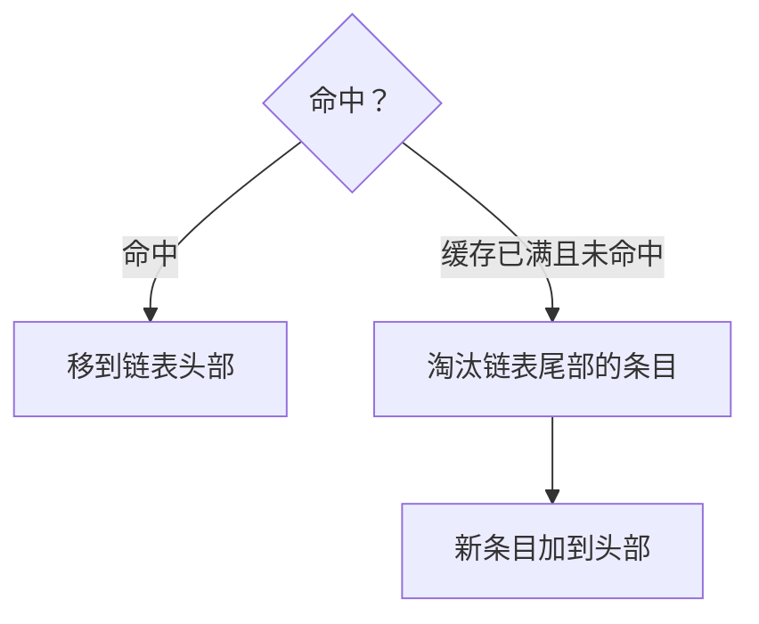

## 本质
哈希表在常数时间内找到条目，双向链表按最近使用时间排序，命中移到头部，满且未命中则淘汰尾部再把新条目加到头部。

## 命题
- P1. 一种常见的 LRU 实现把哈希表和双向链表结合起来。
- P2. 哈希表能在常数时间内找到条目。
- P3. 双向链表按最近一次使用的时间排序。
- P4. 命中时，把该条目移到链表头部。
- P5. 缓存已满且未命中时，淘汰链表尾部的条目，再把新条目加到头部。

## 图

## 直觉与易混对比
- 直觉：哈希表管“找得快”，链表管“谁最久没用”，两者分工。

## 相关
- depends_on:: [[LRU 淘汰策略]]（这是 LRU 策略的具体实现方式。）

## 复习卡
LRU 的常见实现用了哪两种数据结构？各自负责什么？::哈希表在常数时间内找到条目；双向链表按最近一次使用的时间排序。
在这种实现里，命中时怎么做？::把该条目移到链表头部。
缓存已满且未命中时怎么做？::淘汰链表尾部的条目，再把新条目加到头部。
