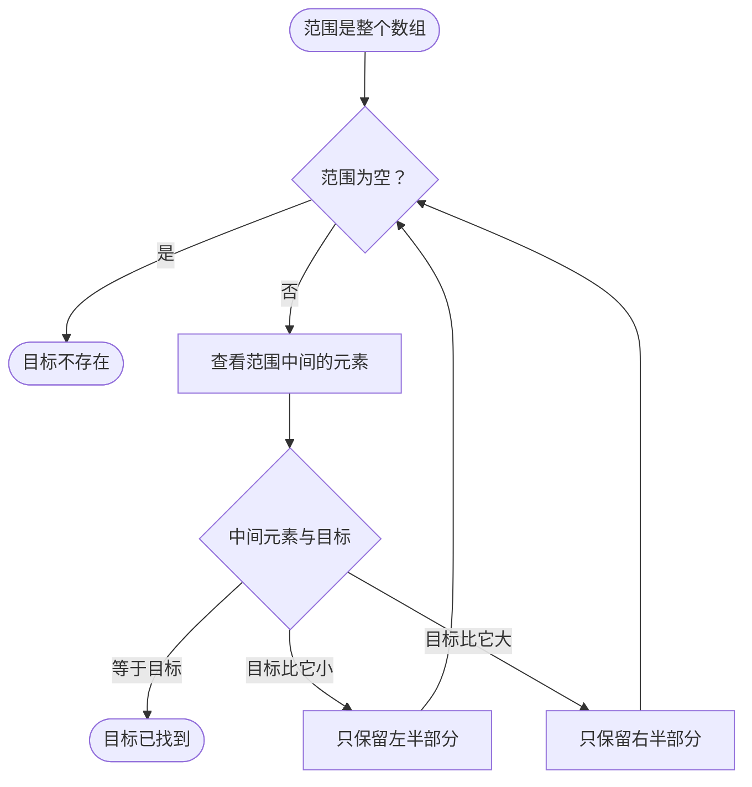

## 本质
二分查找在有序数组中维护一个必含目标的范围，每轮看中间元素并把范围缩小一半。

## 命题
- P1. 二分查找在有序数组中查找一个值。
- P2. 它维护一个范围：只要目标存在，就一定在这个范围内；一开始范围是整个数组。
- P3. 每轮先判断范围是否为空，为空则目标不存在；否则查看范围中间的元素。
- P4. 中间元素等于目标则停止，目标已找到；目标比中间元素小则只保留左半部分，比它大则只保留右半部分，然后回到第一步。
- P5. 每一轮都把范围缩小一半。
- P6. 数组必须有序；在无序数据上，二分查找可能漏掉实际存在的值。

## 图

## 直觉与易混对比
- 直觉：每次比较都能确定目标不可能在被丢掉的那一半。

## 相关
- example_of:: [[对数时间]]（二分查找每步把范围缩小一半，是每步按常数因子缩小问题、得到对数时间的例子。）
- contrasts_with:: [[线性查找]]（线性查找不需要有序，二分查找需要。）
- has_part:: [[二分查找中点计算的溢出]]（中点计算是实现时的经典错误点。）
- similar_to:: [[平衡搜索树的查找代价]]
- required_by:: [[一次查找与多次查找的取舍]]

## 复习卡
二分查找维护的范围有什么性质？::只要目标存在，就一定在这个范围内；一开始这个范围是整个数组。
二分查找每一轮怎样更新范围？::看中间元素：相等则停止；目标更小保留左半部分，更大保留右半部分；范围为空则目标不存在。
为什么二分查找要求数组有序？::在无序数据上，丢掉一半后目标可能仍在被丢掉的部分，所以可能漏掉实际存在的值。
