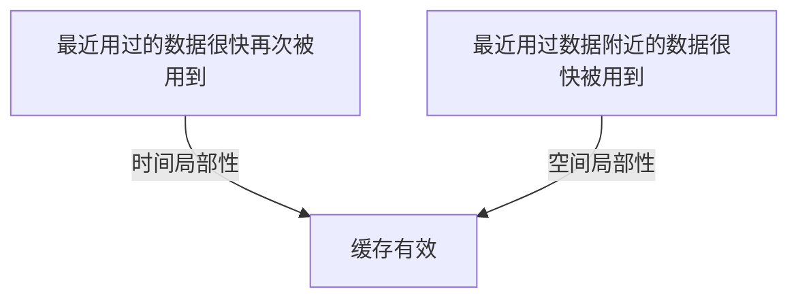

## 本质
程序并非随机访问数据，访问局部性（时间局部性与空间局部性）是缓存有效的原因。

## 命题
- P1. 缓存有效，是因为程序并不是随机访问数据的，这叫访问局部性（locality of reference）。
- P2. 时间局部性（temporal locality）：最近用过的数据，很可能很快再次被用到。
- P3. 空间局部性（spatial locality）：存放在最近用过的数据附近的数据，很可能很快被用到。
- P4. 因为有空间局部性，缓存一次载入整块数据，而不是单个字节。
- P5. 遍历数组的循环同时受益于这两种局部性。
- P6. 在大数据集中随机跳着访问的程序，用什么缓存都收益甚微，因为它没有局部性可利用。

## 图

## 直觉与易混对比
- 直觉：访问有规律可循，缓存才有东西可赌。
- 易混对比：时间局部性看“同一份数据多久再用”；空间局部性看“相邻的数据是否会被用到”。

## 相关
- depends_on:: [[缓存与命中未命中]]（局部性是为了解释缓存为何能得到较高命中。）
- required_by:: [[LRU 淘汰策略]]（LRU 赌的是时间局部性。）

## 复习卡
什么是访问局部性？它与缓存有什么关系？::程序并不是随机访问数据，而是有规律地访问，这叫访问局部性；缓存之所以有效正是因为它。
时间局部性和空间局部性分别是什么？::时间局部性：最近用过的数据很可能很快再次被用到。空间局部性：存放在最近用过的数据附近的数据很可能很快被用到。
缓存为什么一次载入整块数据而不是单个字节？::因为空间局部性：附近的数据很可能很快被用到。
哪类程序用缓存收益甚微？::在大数据集中随机跳着访问的程序。
