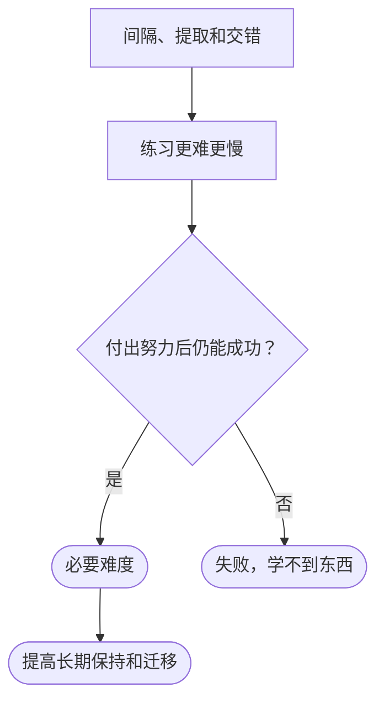

## 本质
间隔、提取和交错让练习更难、更慢、期间表现更差，却提高长期保持和迁移；只有学习者付出努力后仍能成功，这种难度才算必要难度。

## 命题
- P1. 间隔、提取和交错有一个共同规律：让练习感觉更难、更慢，也让练习期间的表现变差。
- P2. 同样是这些条件，却能提高长期保持效果，以及向新问题的迁移。
- P3. 心理学家罗伯特·比约克（Robert Bjork）把这类条件称为必要难度。
- P4. 边界条件：只有学习者付出努力后仍能成功，这种难度才算必要难度。
- P5. 任务太难只会导致失败，学不到东西。

## 图

## 直觉与易混对比
- 易混对比：必要难度不是越难越好：难到学习者努力后也无法成功，就不再是必要难度。

## 相关
- has_example:: [[提取练习]]（提取是三种必要难度之一。）
- has_example:: [[交错练习]]（交错是三种必要难度之一。）

拓展：可能存在关系（1 条）

- [[练习期间的表现不能预测长期效果]] — required_by（该规律解释为什么练习期间的表现会误导对方法的评价。）

## 复习卡
什么是必要难度？哪些做法属于它？::让练习更难、更慢、期间表现更差，却能提高长期保持和向新问题迁移的条件。间隔、提取和交错都属于。
难度在什么条件下才算“必要难度”？::学习者付出努力后仍能成功。任务太难只会导致失败，学不到东西。
谁提出了必要难度这个说法？::心理学家罗伯特·比约克（Robert Bjork）。
