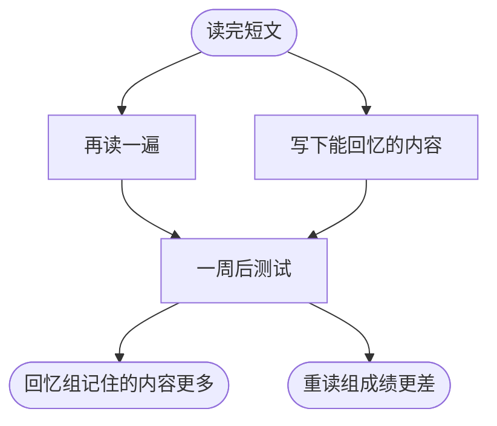

## 本质
尝试从记忆中回想信息，比再读一遍更能巩固这条记忆。

## 命题
- P1. 回答问题、把记得的内容全部写下来、不看笔记讲解一个概念，都属于提取。
- P2. 提取练习又叫测试效应：主动回想比重读更能巩固记忆。
- P3. 典型实验中，学生读完短文后，一组再读一遍，另一组写下能回忆的内容，全程没有反馈；一周后测试，回忆组记住的内容更多。
- P4. 重读组当时自我感觉更有把握，但实际成绩更差，说明自我感觉不能代替实际测试。

## 图

## 直觉与易混对比
- 直觉：重读是让信息再进来一次，提取是让信息自己出来一次；后者练的正是考试和应用时要用的动作。
- 易混对比：提取练习不等于重读：重读时信息就在眼前，提取要求在没有提示时自己回想。

## 相关
- has_example:: [[提取中的反馈与抽认卡]]（抽认卡是提取练习的常见形式。）
- example_of:: [[必要难度]]（提取让练习更费力，却提高长期保持，是必要难度的一种。）

拓展：可能存在关系（1 条）

- [[流畅错觉]] — required_by

## 复习卡
什么是提取练习（测试效应）？::尝试从记忆中回想信息，而不是再读一遍。它比重读更能巩固这条记忆。
典型的提取练习实验是怎样设计的，结果如何？::学生先读短文，然后一组再读一遍，另一组写下能回忆的内容，全程没有反馈。一周后测试，回忆组记住的内容更多。
实验中重读组的自我感觉怎样，这说明什么？::重读组当时自我感觉更有把握，但成绩更差，说明自我感觉不能代替实际测试。
