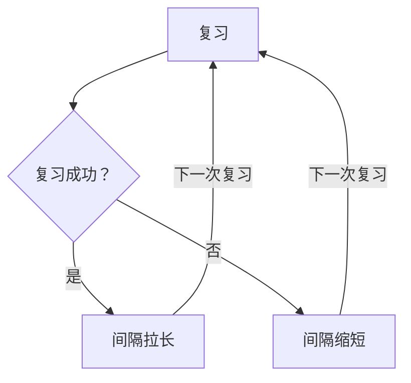

## 本质
每次成功复习都让记忆更稳定，所以下次复习可以等得更久；失败则缩短间隔。

## 命题
- P1. 每次成功的复习都让记忆更稳定，下一次复习就可以等得更久。
- P2. 间隔重复系统利用了这一点：每成功复习一次，到下一次复习的间隔就拉长一些，例如 1 天、3 天、8 天、3 周。
- P3. 一次复习失败，间隔又会缩短。

## 图

## 直觉与易混对比
暂无。

## 相关
- depends_on:: [[费力但成功的提取更能提高稳定性]]（成功提取提高稳定性，才使间隔可以拉长。）
- depends_on:: [[记忆的稳定性]]（间隔长度随稳定性增长。）

拓展：可能存在关系（2 条）

- [[间隔效应]] — example_of（间隔重复系统是间隔效应的应用。）
- [[调度程序按目标回忆概率安排复习]] — has_part

## 复习卡
间隔重复系统为什么能逐步拉长复习间隔？::每次成功的复习都让记忆更稳定，所以下一次复习可以等得更久。
复习成功和失败时，间隔分别怎样变化？::成功则间隔拉长（例如 1 天、3 天、8 天、3 周）；失败则间隔缩短。
