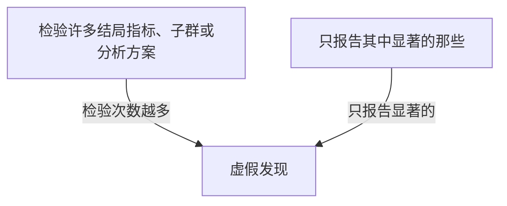

## 本质
检验的次数越多，偶然得到“显著”结果的机会越大；只报告显著的那些会产生虚假发现。

## 命题
- P1. 以 0.05 为阈值检验 20 个相互独立、而且全都不成立的假设，至少出现一个“显著”结果的概率约为 64%。
- P2. 检验许多结局指标、子群或分析方案，却只报告其中显著的那些，就会产生虚假发现。

## 图

## 直觉与易混对比
- 直觉：每次检验都有一点偶然“中奖”的机会，次数累积起来，总会中奖的概率就远大于 5%。

## 相关
- depends_on:: [[p 值的定义]]（“显著”指 p 值低于阈值，需要先懂 p 值。）
- required_by:: [[多重比较的补救办法]]（补救办法针对这一问题。）

## 复习卡
以 0.05 为阈值，检验 20 个相互独立且全都不成立的假设，至少出现一个“显著”结果的概率约是多少？::约 64%。
怎样的做法会产生虚假发现？::检验许多结局指标、子群或分析方案，却只报告其中显著的那些。
