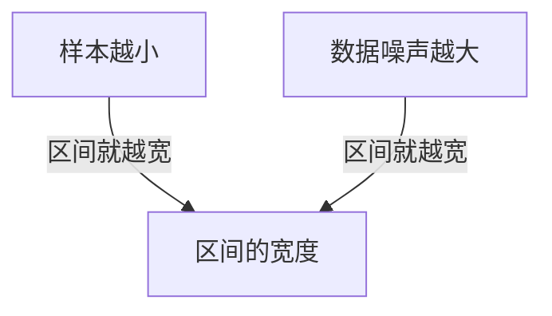

## 本质
置信区间越窄，估计越精确；样本越小、数据噪声越大，区间越宽。

## 命题
- P1. 区间的宽度表示估计有多精确。
- P2. 样本越小，区间就越宽。
- P3. 数据噪声越大，区间就越宽。

## 图

## 直觉与易混对比
暂无。

## 相关

拓展：可能存在关系（1 条）

- [[统计显著性不等于实际显著性]] — required_by

## 复习卡
置信区间的宽度表示什么？::表示估计有多精确：区间越窄，估计越精确。
哪两个因素会让置信区间变宽？::样本越小，以及数据噪声越大。
