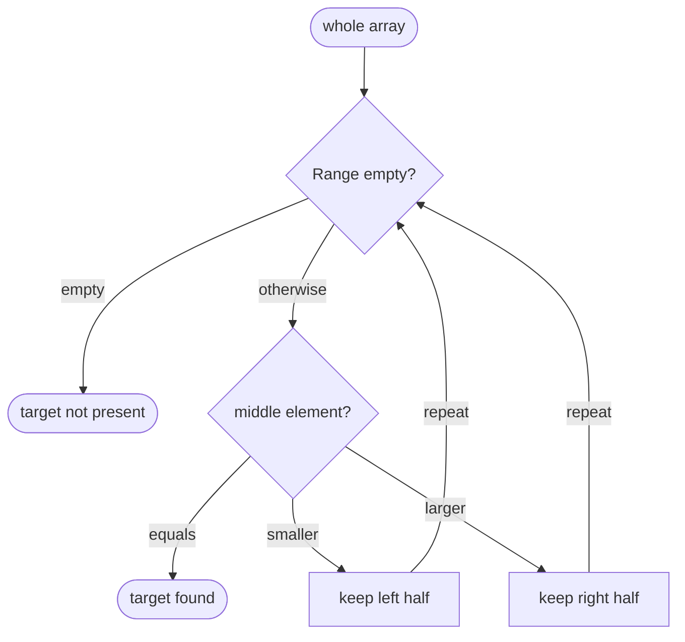

## Essence
Binary search finds a value in a sorted array by keeping a range that must contain the target and halving it on each pass.

## Propositions
- P1. Binary search finds a value in a sorted array.
- P2. It keeps a range that must contain the target if the target is present at all, starting with the whole array.
- P3. If the range is empty, the target is not present.
- P4. Otherwise it looks at the middle element: if it equals the target, the target is found.
- P5. If the target is smaller than the middle element, keep only the left half; if it is larger, keep only the right half; then repeat.
- P6. Each pass halves the range.
- P7. The array must be sorted; on unsorted data binary search can miss values that are present.

## Diagram

## Intuition and contrasts
- Intuition: The sorted order lets one comparison with the middle rule out half of the remaining candidates.

## Related
- example_of:: [[Logarithmic time]] (Halving the range each pass makes binary search the standard logarithmic-time example.)
- contrasts_with:: [[Linear search versus sorting first]] (Binary search needs sorted data; linear search does not.)
- has_part:: [[Binary search midpoint overflow bug]]

## Review cards
What invariant does binary search keep about its range?::The range must contain the target if the target is present at all; it starts as the whole array.
What does binary search do after comparing the target with the middle element?::If equal, it stops (found). If the target is smaller, it keeps the left half; if larger, the right half. An empty range means the target is not present.
What happens if binary search runs on unsorted data?::It can miss values that are present, so the array must be sorted.
