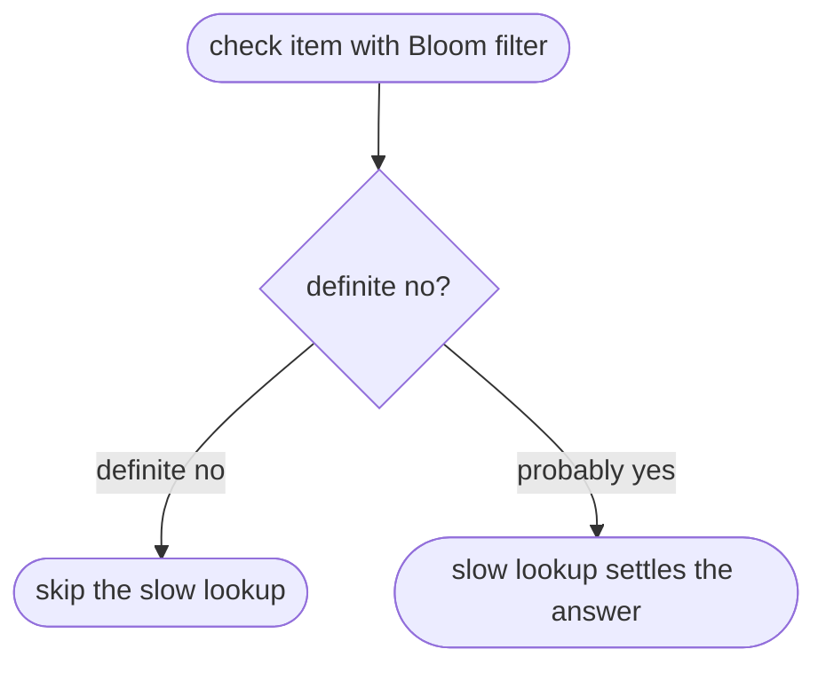

## Essence
A Bloom filter sits in front of a slow lookup to skip it for definite negatives, but when the checked items are rarely in the set many probably-yes answers are false, so the slow lookup must settle them.

## Propositions
- P1. Bloom filters are used as a cheap first check in front of a slow lookup, for example before reading from disk.
- P2. A definite no from the filter lets the program skip the slow lookup.
- P3. When the items being checked are rarely in the set, a large share of the probably-yes answers can be false positives.
- P4. This has the same cause as a positive screening test for a rare disease being often wrong.
- P5. The slow lookup then settles the answer.

## Diagram

## Intuition and contrasts
- Intuition: The filter removes most useless slow lookups, but a probably-yes is only a reason to look, not a result.
- Contrast: A probably-yes from a Bloom filter is not a confirmed membership: it must be confirmed by the real lookup.

## Related
- depends_on:: [[Bloom filter operation and its one-sided error]] (It uses the no false negatives and possible false positives property.)
- similar_to:: [[Screening test with a rare disease]] (The source gives the rare-disease screening test as the same reason.)

Extension: possible relations (1)

- [[Positive predictive value]] — example_of (A low base rate of members lowers the share of true positives among the probably-yes answers.)

## Review cards
Where is a Bloom filter typically used in a system?::As a cheap first check in front of a slow lookup, for example before reading from disk.
Why can many probably-yes answers be false positives?::When the checked items are rarely in the set, most checks are for absent items, so false positives make up a large share of the positives, as with a positive screening test for a rare disease.
What settles a probably-yes answer from a Bloom filter?::The slow lookup.
