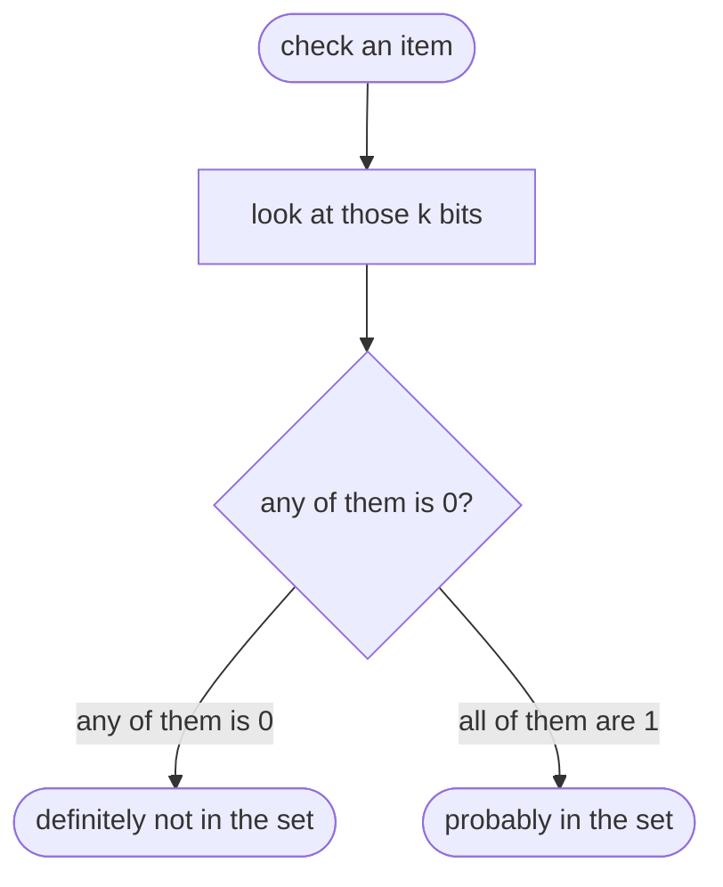

## Essence
A Bloom filter is a bit array with k hash functions that tests set membership in little memory, with no false negatives but possible false positives.

## Propositions
- P1. A Bloom filter answers whether an item is in the set with much less memory than storing the items.
- P2. It is a bit array plus k hash functions.
- P3. To add an item, set the k bits that its hashes point to.
- P4. To check an item, look at those k bits: if any of them is 0, the item is definitely not in the set; if all of them are 1, the item is probably in the set.
- P5. A Bloom filter has no false negatives but can have false positives.
- P6. The false positive rate grows as more items are added.
- P7. Items cannot be removed from a basic Bloom filter.

## Diagram

## Intuition and contrasts
- Intuition: Each added item leaves k marks; a zero at any of an item's marks proves it was never added, while all marks set may be caused by other items.
- Contrast: A Bloom filter differs from a hash table: it does not store the items or their values, so it can only say definitely not or probably yes.

## Related
- required_by:: [[Bloom filter as a cheap first check and the rare-item false positive problem]] (The use as a pre-check relies on the one-sided error.)

Extension: possible relations (2)

- [[What makes a good hash function for a table]] — depends_on (It relies on k hash functions that spread items over the bit array.)
- [[Hash table lookup and its average and worst case cost]] — contrasts_with (Both use hashing, but the Bloom filter trades exact answers for less memory.)

## Review cards
How does a Bloom filter add and check an item?::Adding sets the k bits that the item's k hashes point to; checking looks at those k bits. Any 0 means definitely not in the set; all 1 means probably in the set.
Which error can a Bloom filter make, and which can it not make?::It can give false positives but never false negatives.
What happens to the false positive rate as more items are added, and can items be removed?::The false positive rate grows; items cannot be removed from a basic Bloom filter.
