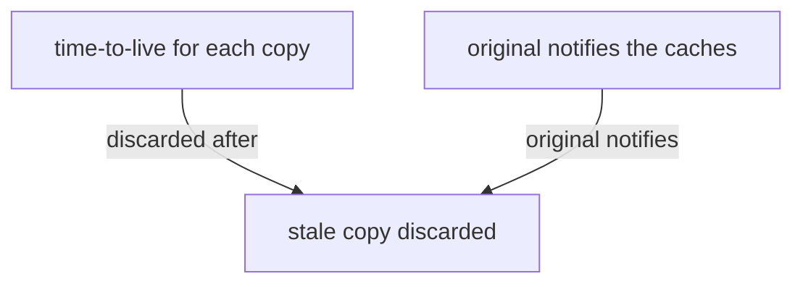

## Essence
A cached copy becomes stale when the original changes, so systems discard copies by time-to-live or by notification from the original; getting it wrong serves outdated data.

## Propositions
- P1. A cached copy becomes stale when the original changes.
- P2. One approach gives each copy a time-to-live after which it is discarded.
- P3. Another approach has the original notify the caches when it changes.
- P4. Getting invalidation wrong serves outdated data.
- P5. For this reason cache invalidation has a reputation as one of the hard problems in computing.

## Diagram

## Intuition and contrasts
- Intuition: A copy is only as good as its last check against the original.

## Related
- depends_on:: [[Cache as a small fast copy of a larger slower store]] (Staleness concerns cached copies of an original.)

## Review cards
When does a cached copy become stale?::When the original changes.
What are the two ways systems handle stale copies?::Give each copy a time-to-live after which it is discarded, or have the original notify the caches when it changes.
What is the consequence of getting cache invalidation wrong?::Outdated data is served.
