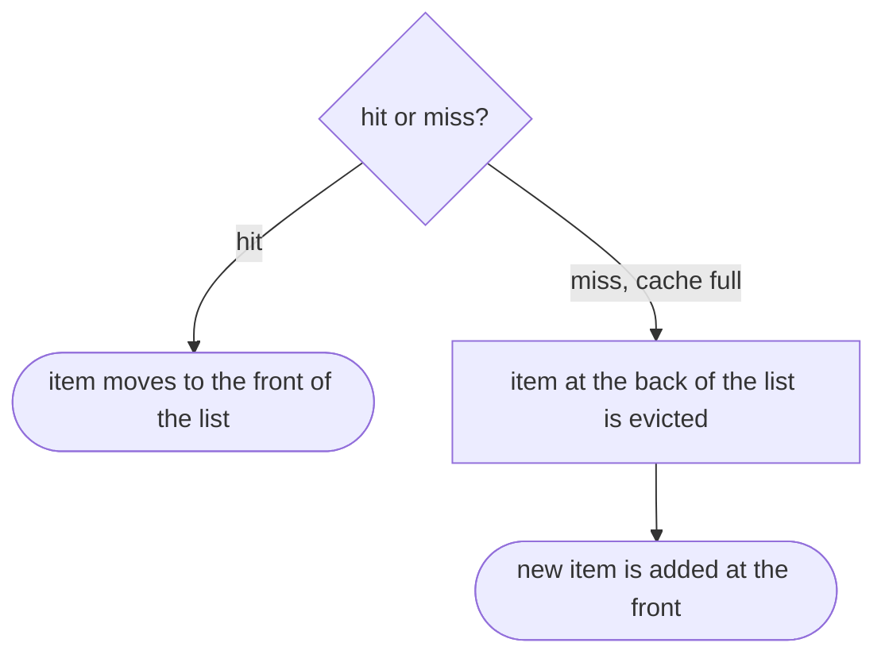

## Essence
LRU evicts the item unused for the longest time, usually implemented with a hash table plus a doubly linked list ordered by last use, and it fails on one large scan.

## Propositions
- P1. When the cache is full and a new item must be stored, an old item has to be evicted.
- P2. Least recently used (LRU) eviction removes the item that has gone unused for the longest time, betting on temporal locality.
- P3. A common implementation combines a hash table, which finds an item in constant time, with a doubly linked list ordered by last use.
- P4. On a hit, the item moves to the front of the list.
- P5. On a miss with a full cache, the item at the back of the list is evicted and the new item is added at the front.
- P6. LRU does badly on one large scan that touches every item once: the scan pushes out everything useful.

## Diagram

## Intuition and contrasts
- Intuition: The list is a queue of recency: front is freshest, back is the next to go.

## Related
- depends_on:: [[Locality of reference]] (LRU bets on temporal locality.)
- depends_on:: [[Cache as a small fast copy of a larger slower store]] (Eviction applies to a full cache with hits and misses.)

## Review cards
Which item does LRU evict, and what is it betting on?::The item unused for the longest time; it bets on temporal locality.
Which two structures are combined in a common LRU implementation, and what does each do?::A hash table finds an item in constant time; a doubly linked list ordered by last use tracks recency.
What happens to the list on a hit, and on a miss with a full cache?::On a hit the item moves to the front. On a miss with a full cache the back item is evicted and the new item is added at the front.
When does LRU perform badly?::On one large scan that touches every item once, because it pushes out everything useful.
