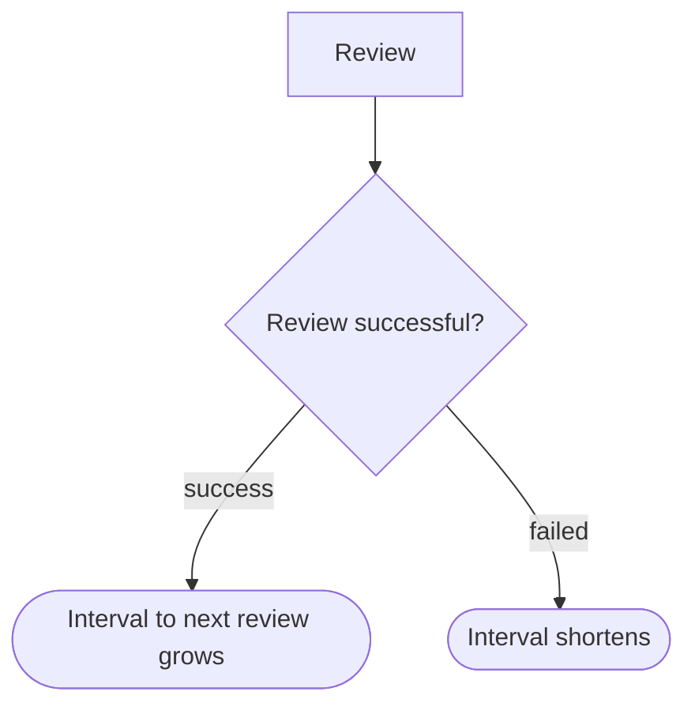

## Essence
Because each successful review makes a memory more stable, spaced repetition systems let the interval to the next review grow after every success and shorten it after a failure.

## Propositions
- P1. If each successful review makes a memory more stable, the next review can wait longer.
- P2. Spaced repetition systems use this: after each successful review the interval to the next review grows.
- P3. An example sequence of intervals is 1 day, 3 days, 8 days, 3 weeks.
- P4. A failed review shortens the interval again.

## Diagram

## Intuition and contrasts
None yet.

## Related
- depends_on:: [[Memory stability]] (Longer intervals are justified because successful reviews increase stability.)
- required_by:: [[Scheduling reviews at a target recall probability]]

Extension: possible relations (1)

- [[The spacing effect]] — depends_on (Expanding intervals apply the idea of spreading study over time.)

## Review cards
Why can review intervals grow in a spaced repetition system?::Each successful review makes the memory more stable, so the next review can wait longer.
What happens to the interval after a failed review?::It is shortened again.
Give an example of expanding intervals.::1 day, 3 days, 8 days, 3 weeks.
