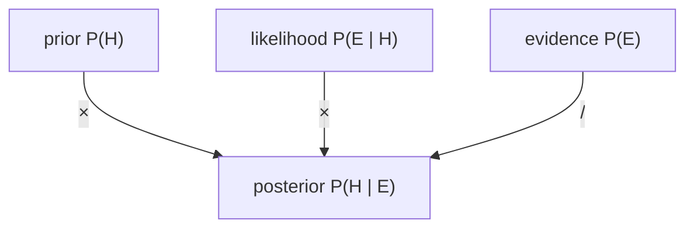

## Essence
Bayes' rule computes the posterior P(H | E) from the likelihood P(E | H), the prior P(H) and the total probability of the evidence P(E).

## Propositions
- P1. Bayes' rule turns one conditional probability into the other: P(H | E) = P(E | H) × P(H) / P(E).
- P2. H is a hypothesis and E is the evidence.
- P3. P(H) is the prior, the probability of the hypothesis before seeing the evidence.
- P4. P(E | H) is the likelihood of the evidence if the hypothesis is true.
- P5. P(H | E) is the posterior, the probability after seeing the evidence.
- P6. The denominator can be computed as P(E) = P(E | H) × P(H) + P(E | not H) × P(not H).

## Diagram

## Intuition and contrasts
None yet.

## Related
- depends_on:: [[Conditional probability]] (The rule is a relation between two conditional probabilities.)
- has_example:: [[Screening test with a rare disease]] (The screening test applies the rule with a rare disease.)
- has_part:: [[How strongly evidence changes a belief]]
- required_by:: [[Positive predictive value]]

## Review cards
State Bayes' rule for a hypothesis H and evidence E.::P(H | E) = P(E | H) × P(H) / P(E).
What are the prior, the likelihood and the posterior in Bayes' rule?::The prior is P(H), the probability before the evidence. The likelihood is P(E | H). The posterior is P(H | E), the probability after the evidence.
How can the denominator P(E) be computed?::P(E) = P(E | H) × P(H) + P(E | not H) × P(not H).
