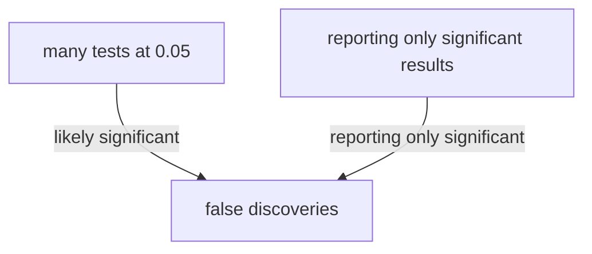

## Essence
Running many tests at a 0.05 threshold makes at least one false significant result likely, so reporting only significant results produces false discoveries unless the testing is pre-registered, corrected or replicated.

## Propositions
- P1. If a researcher tests 20 independent hypotheses that are all false at a threshold of 0.05, the chance of at least one significant result is about 64 percent.
- P2. Testing many outcomes, subgroups or analysis choices and reporting only the significant ones produces false discoveries.
- P3. Pre-registration, stating the hypothesis before collecting the data, is one remedy.
- P4. The Bonferroni correction adjusts the threshold for the number of tests by dividing 0.05 by the number of tests.
- P5. Repeating the study on new data is another remedy.

## Diagram

## Intuition and contrasts
- Intuition: Each test is a fresh lottery ticket with a 5 percent chance of a false win, so many tickets make a win likely.

## Related
- depends_on:: [[What a p-value is and is not]] (The inflation arises from applying a fixed p-value threshold repeatedly.)

## Review cards
If 20 independent false hypotheses are each tested at 0.05, what is the chance of at least one significant result?::About 64 percent.
How does the Bonferroni correction adjust the threshold?::It divides 0.05 by the number of tests.
Name three remedies for the multiple comparisons problem.::Pre-registration, adjusting the threshold for the number of tests (such as Bonferroni), and repeating the study on new data.
