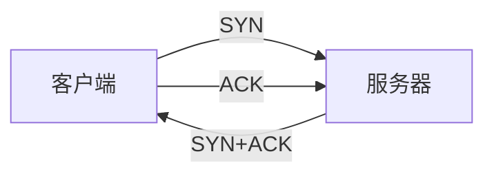

## 本质
客户端与服务器交换三个报文段后才建立连接。

## 命题
- P1. 客户端发送 SYN，进入 SYN_SENT。
- P2. 服务器回复 SYN+ACK，进入 SYN_RCVD。
- P3. 客户端回复 ACK 后双方进入 ESTABLISHED。

## 图

## 直觉与易混对比
- 直觉：先确认双方都能收发。

## 相关
- [[TCP 四次挥手]] — similar_to（同一连接的两端）
- [[可靠传输]] — depends_on（序号与确认）

## 复习卡
三次握手第二个报文是什么？::SYN+ACK
