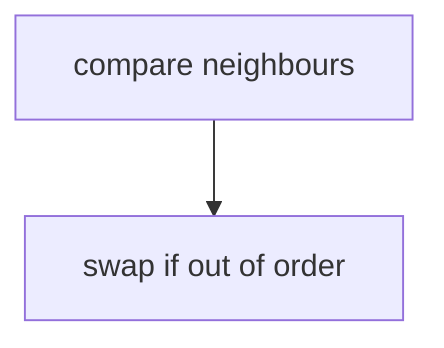

## Essence
Swap neighbours that are out of order; each pass moves the largest value to the end.

## Propositions
- P1. Each pass compares neighbours from the start and swaps them when they are out of order.

## Diagram


## Code
```python
## not a heading inside a code block
for i in range(n):
    pass
```

## Related
- contrasts_with:: [[Selection sort]] (number of swaps)
