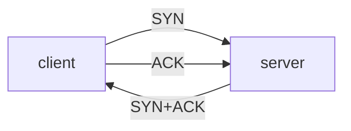

## Essence
A client and a server exchange three segments before the connection is open.

## Propositions
- P1. The client sends SYN and enters SYN_SENT.
- P2. The server answers SYN+ACK and enters SYN_RCVD.
- P3. After the client sends ACK, both sides enter ESTABLISHED.

## Diagram

## Intuition and contrasts
- Intuition: first make sure both sides can send and receive.

## Related
- similar_to:: [[TCP connection teardown]] (both ends of one connection)
- depends_on:: [[Reliable transport]] (sequence numbers and acknowledgements)

## Review cards
What is the second segment of the handshake?::SYN+ACK
